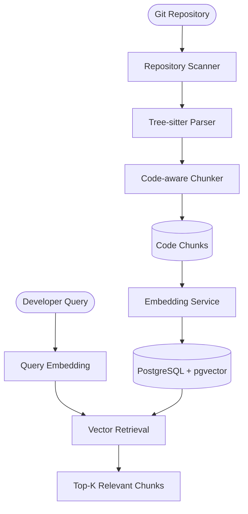

# 🧠 RepoIntel AI

A codebase intelligence platform for parsing, indexing, and semantically retrieving relevant context from software repositories.

RepoIntel transforms source repositories into structured representations using Tree-sitter parsing, code-aware chunking, local embeddings, and vector search.

---

## What it does

RepoIntel processes a repository through the following pipeline:

```text
Repository
    ↓
File Scanning
    ↓
AST Parsing
    ↓
Symbol Extraction
    ↓
Code-aware Chunking
    ↓
Embedding Generation
    ↓
pgvector / HNSW
    ↓
Semantic Retrieval
```

The current version focuses on building a reliable **repository-scoped retrieval system** that can serve as the foundation for future codebase intelligence and RAG capabilities.

---

## Architecture


---

## Key Components

**AST-aware parsing.** Tree-sitter is used to parse supported programming languages and extract meaningful code symbols such as classes, functions, and methods.

**Code-aware chunking.** AST-supported languages use symbol-aware chunks, while unsupported languages fall back to text-based chunking.

**Local embeddings.** Code chunks are embedded locally using `BAAI/bge-small-en-v1.5` with 384-dimensional vectors.

**Vector retrieval.** PostgreSQL with `pgvector` and HNSW provides approximate nearest-neighbor search.

**Repository isolation.** Retrieval is scoped to a specific repository so unrelated repositories do not contribute results.

**Hybrid retrieval.** Dense vector search and repository-scoped BM25 are combined with Reciprocal Rank Fusion (RRF). BM25 indexes code text and supports code identifiers, with extra configuration terms for embedding model, batch size, dimensions, and provider questions.

**Cross-encoder reranking.** A local cross-encoder reranks hybrid candidates. Production fusion keeps hybrid relevance as the main signal and uses the cross-encoder as supporting evidence; reranker loading is lazy and inputs are capped to limit latency.

**Graph retrieval experiments.** A separate graph-enhanced retrieval service expands candidates through repository relationships and scores them against the query. The production Swagger route remains the single hybrid + conditional-reranking endpoint; graph modes are evaluated through offline runners.

**Retrieval diagnostics.** The API can report stage latency, whether reranking ran, ranking policy, and dense, hybrid, and cross-encoder scores. Offline evaluation reports Hit@K, Recall@K, Precision@K, MRR, nDCG, and query-level results.

---

## Project Structure

```text
RepoIntel-AI/
│
├── backend/
│   ├── app/
│   │   ├── api/
│   │   ├── core/
│   │   ├── crud/
│   │   ├── models/
│   │   ├── schemas/
│   │   ├── services/
│   │   │   ├── repository/
│   │   │   ├── parsers/
│   │   │   ├── chunking/
│   │   │   ├── embedding/
│   │   │   ├── vector_store/
│   │   │   └── retrieval/
│   │   └── main.py
│   │
│   ├── alembic/
│   ├── benchmarks/
│   ├── tests/
│   ├── pyproject.toml
│   └── uv.lock
│
├── .gitignore
├── .python-version
└── README.md
```

---

## Tech Stack

- Python 3.12+
- FastAPI
- PostgreSQL
- pgvector
- HNSW
- SQLAlchemy 2
- Alembic
- Tree-sitter
- Sentence Transformers
- BAAI/bge-small-en-v1.5
- pytest
- uv

---

## Retrieval Evaluation

Results below were measured on the local RepoIntel-AI indexed corpus (repository ID `49`, 121 files, 847 chunks; 633 source chunks after excluding tests and fixtures). They are benchmark snapshots, not guarantees for other repositories. V1 uses eight labeled queries; V2 uses 50 answerable queries across conceptual, identifier, configuration, and path categories, plus eight no-answer queries.

### V2 layer comparison

Quality metrics are percentages. `MRR@5` and `nDCG@5` are also shown as percentages for readability.

| Retrieval layer | Hit@1 | Hit@3 | Hit@5 | Recall@5 | Precision@5 | MRR@5 | nDCG@5 |
|---|---:|---:|---:|---:|---:|---:|---:|
| Dense only | 56.0 | 90.0 | 94.0 | **90.3** | **26.8** | **71.7** | **73.3** |
| BM25 only | 42.0 | 72.0 | 82.0 | 71.0 | 19.6 | 56.8 | 56.8 |
| Hybrid RRF only | 50.0 | 84.0 | 94.0 | 85.0 | 24.0 | 68.7 | 68.5 |
| Cross-encoder reranking | 52.0 | 82.0 | 90.0 | 84.7 | 24.8 | 67.9 | 68.7 |
| Weighted RRF + cross-encoder | 54.0 | 86.0 | 94.0 | 85.0 | 24.0 | 71.0 | 69.5 |
| Production hybrid baseline | 54.0 | 88.0 | 94.0 | 85.0 | 24.0 | 71.7 | 70.1 |
| Graph enhanced | 54.0 | 80.0 | 92.0 | 82.3 | 23.2 | 69.0 | 67.4 |
| Graph-only, dense-seeded | 46.0 | 48.0 | 58.0 | 43.3 | 12.0 | 49.2 | 40.6 |

Dense led V2 on Recall@5 and nDCG@5. BM25 was strongest for exact identifiers (Recall@5 100.0%, MRR@5 80.6%) and weaker for conceptual queries (Recall@5 50.0%). The no-answer false-positive rate was **100%** for every tested layer: the current retrieval pipeline does not abstain when evidence is weak.

### Latest V1 retrieval checks

The latest focused eight-query checks after the configuration-query ranking changes produced:

| Layer | Hit@1 | Hit@3 | Hit@5 | Recall@5 | Precision@5 | MRR@5 | nDCG@5 |
|---|---:|---:|---:|---:|---:|---:|---:|
| Hybrid-only | 62.5 | 100.0 | 100.0 | 91.7 | 27.5 | 79.2 | 77.1 |
| Graph-enhanced | 62.5 | 100.0 | 100.0 | 83.3 | 22.5 | 81.3 | 73.7 |
| V2.2 cross-encoder + 90/10 fusion | 37.5 | 100.0 | 100.0 | 87.5 | 25.0 | 64.6 | 64.2 |

The V2.2 cross-encoder result still misses its Recall@5 threshold of 91.6%. The retrieval test suite is therefore **not fully green**; the last full run was 207 passed, 3 failed, and 1 skipped. The latest focused rerun passed 32 checks and still failed the V2.2 Recall@5 gate. Do not treat the V1 and V2 tables as directly comparable: they use different query sets and evaluation modes.

### Latency snapshots

Earlier offline V2 runner results, median / p95 milliseconds per query (model initialization excluded):

| Layer | p50 ms | p95 ms |
|---|---:|---:|
| Dense only | 15.8 | 28.6 |
| BM25 only, warm | 1.5 | 2.5 |
| Hybrid RRF only | 17.4 | 23.0 |
| Cross-encoder reranking | 426.5 | 482.1 |
| Weighted RRF + cross-encoder | 205.7 | 239.0 |
| Production hybrid | 60.4 | 291.0 |
| Graph enhanced | 238.2 | 1,835.9 |

BM25's first query, including index construction, measured 46.7 ms in that run. Latency varies by machine, warmup, and concurrent load. The most recent ranking changes have **not** been followed by a new latency benchmark, so these are historical measurements rather than current latency guarantees.

For detailed pre-PR/post-PR comparisons, Swagger instructions, query labels, and rerun commands, see [`reports/retrieval-quality/retrieval-evaluation-and-swagger-guide.md`](reports/retrieval-quality/retrieval-evaluation-and-swagger-guide.md).

---

## Getting Started

### Requirements

- Python 3.12+
- PostgreSQL with `pgvector`
- uv
- Git

### Installation

```bash
git clone https://github.com/AyushhVatsal/RepoIntel-AI.git
cd RepoIntel-AI/backend

uv sync
```

Configure the required environment variables in `.env`.

Run migrations:

```bash
uv run alembic upgrade head
```

Start the API:

```bash
uv run uvicorn app.main:app --reload
```

Run tests:

```bash
uv run pytest
```

---

## Current Status

- Repository ingestion ✅
- File scanning ✅
- Tree-sitter parsing ✅
- Symbol extraction ✅
- Code-aware chunking ✅
- Embedding pipeline ✅
- PostgreSQL + pgvector ✅
- HNSW indexing ✅
- Dense + BM25 hybrid retrieval ✅
- Conditional cross-encoder reranking ✅
- Graph-enhanced retrieval evaluation ✅
- Retrieval quality and latency instrumentation ✅
- Expanded retrieval evaluation suite ✅

---

## Roadmap

- Improve no-answer abstention
- Raise cross-encoder recall on configuration questions
- Rebenchmark latency after the latest ranking changes
- Context pruning
- Architecture analysis
- Repository-aware codebase chat

---

## License

License information will be added separately.
